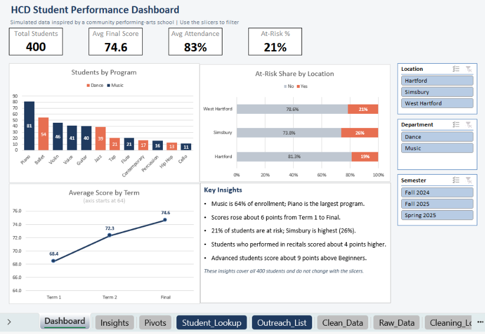
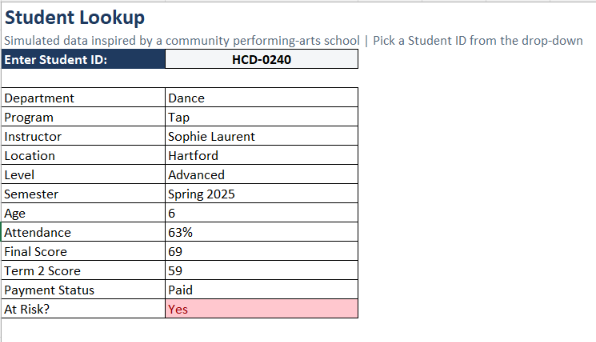
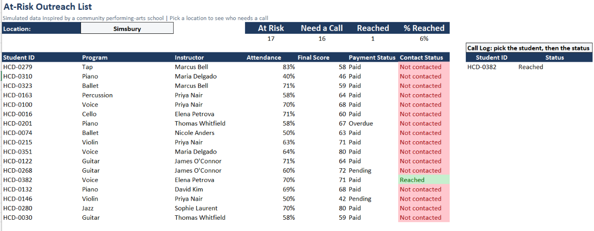

# 📊 HCD Student Performance Dashboard

**An Excel workbook that shows staff which students are at risk, where, and who to contact, without building any reports themselves.**

`Pivot Tables` · `Slicers` · `XLOOKUP` · `FILTER` · `Data Validation` · `Data Cleaning` · `Dashboard Design`

**Answers:** Which locations and programs have the most at-risk students, and what drives performance?

📁 **[Download the workbook](HCD_Student_Performance_Dashboard.xlsx)** (FILTER and XLOOKUP need Excel 365 or 2021+)

---

## 🎯 Headline Result

**21% of students are at risk** (attendance under 75% or final score under 60). Simsbury is highest at **26.2%**, compared with 18.8% in Hartford.

## 🧰 What's Inside

- **Dashboard:** four KPI cards (Total Students, Avg Final Score, Avg Attendance, At-Risk %) and charts that all update together with slicers for Location, Department and Semester. *(PivotTables, GETPIVOTDATA)*
- **Student Lookup:** pick a Student ID from a drop-down and see that student's full profile. *(XLOOKUP, data validation)*
- **At-Risk Outreach List:** choose a location and get a live list of at-risk students, with a count, color-coded flags and a call log that tracks each student's contact status. *(FILTER, COUNTIF, conditional formatting)*
- **Pivots:** students by program, scores by term, and at-risk % by location.
- **Cleaning_Log and Data_Dictionary:** every cleaning step and all 27 columns documented.

## 💡 Key Insights

| Finding | Recommended action |
|---|---|
| **21%** of students are at risk. Simsbury is highest at **26.2%**. | Contact at-risk families after Term 1, starting with Simsbury. It is a smaller site, so confirm with more data. |
| **Advanced** students score about **9 points** higher than Beginners (80.4 vs 71.0). | Give Beginners extra support early. |
| Students who **performed in recitals** score about **4 points** higher (77.2 vs 73.2). | Encourage more students to join showcases. |
| **Music is 64%** of enrollment, and Piano is the largest program (81 of 400 students). | Prioritize piano instructors and studio space. |

*These findings show association, not cause.*

## 🧠 Decisions I Made

- **At-risk definition:** attendance under 75% or final score under 60, so the flag catches both attendance and performance problems.
- **Raw data stays untouched:** all fixes happen in `Clean_Data`. I removed 8 duplicate rows (408 to 400 students) and standardized text with PROPER and TRIM.
- **Blanks left as they are** in Term 2 score, practice hours and participation, because formulas ignore them.
- **Helper column for the KPI cards:** a 1/0 `AtRisk_Flag` lets the cards calculate an at-risk rate from a PivotTable, so they respond to the slicers.

## 🗂️ Dataset & Limitations

400 simulated student records across 3 locations and 12 programs (Music and Dance), modeled on student enrollment and attendance data. Because the data is simulated, the insights illustrate the analysis approach and are not real-world results.

## 📬 Contact

khtibimane23@gmail.com
