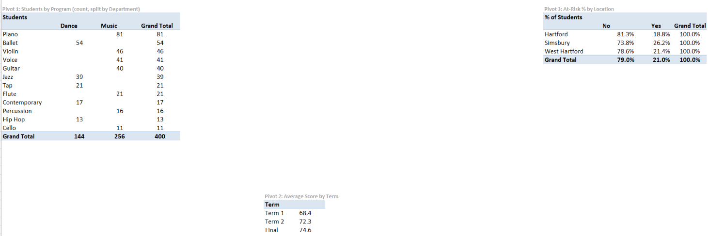

# 📊 HCD Student Performance Dashboard

**End-to-end Excel analytics: raw data to an interactive, slicer-driven dashboard.**

`Data Cleaning` · `Pivot Tables` · `Dashboard Design` · `XLOOKUP` · `FILTER` · `Data Validation`

**Answers:** Which locations and programs have the most at-risk students, and what drives performance?

📁 **[Download the workbook](HCD_Student_Performance_Dashboard.xlsx)** (FILTER and XLOOKUP need Excel 365 or 2021+)

---

## 🗂️ Dataset

400 simulated student records across 3 locations and 12 programs (Music and Dance), inspired by a community performing-arts school. Columns fall into five groups:

- **Enrollment:** Student ID, enrollment date, semester, age
- **Program:** department, program, class type, level, location, instructor
- **Scores:** Term 1, Term 2, final score, recital participation
- **Attendance:** sessions scheduled and attended, weekly practice hours
- **Payments:** payment status

The data is simulated, so the insights below illustrate the analysis approach.

## 🧹 Data Cleaning & Preparation

- `Raw_Data` is kept untouched. All fixes happen in `Clean_Data`.
- Removed 8 duplicate rows (408 to 400 students) and standardized text with PROPER and TRIM.
- Every step is recorded in `Cleaning_Log`, and every column is explained in `Data_Dictionary`.
- **Feature engineering:** Attendance %, Grade Band, At-Risk flag, Overdue flag, Improvement.
- Built on structured tables with data validation.

## 📈 Analysis & Interactive Dashboard

- **Pivot tables** for students by program, scores by term, and at-risk % by location
- **KPI cards** (Total Students, Avg Final Score, Avg Attendance, At-Risk %) powered by `GETPIVOTDATA`
- **Charts and slicers** for Location, Department and Semester, so every card and chart updates together

## 💡 Key Insights

| Finding | Recommendation |
|---|---|
| **21%** of students are at risk (attendance under 75% or final score under 60). Simsbury is highest at **26.2%**, vs 18.8% in Hartford. | Contact at-risk families after Term 1, starting with Simsbury. It is a smaller site, so confirm with more data. |
| **Advanced** students score about **9 points** higher than Beginners (80.4 vs 71.0). | Give Beginners extra support early. |
| Students who **performed in recitals** score about **4 points** higher (77.2 vs 73.2). | Encourage more students to join showcases. |
| **Music is 64%** of enrollment, and Piano is the largest program (81 of 400 students). | Prioritize piano instructors and studio space. |

*These findings show association, not cause.*

## 🔍 Interactive Tools

**Student Lookup:** pick a Student ID from a drop-down to see that student's full profile (`XLOOKUP`, data validation).

**At-Risk Outreach List:** choose a location to get a live list of at-risk students (`FILTER` dynamic arrays), with a `COUNTIF` summary, conditional formatting, and a call log that tracks each student's contact status.

## 📬 Contact

khtibimane23@gmail.com
